

<!-- ═══════════════ BAGIAN 1 (No. 1 - 4) ═══════════════ -->

<!-- Banner cyberpunk: glitch title + matrix rain + animated gradient + running borders -->

<!-- 1. FOTO PROFIL (circle avatar dari GitHub) -->

<!-- 2 + 3. Typing animation "Hallo saya Feby Awie" (1x permanen + 👋)
           + "Web Development / Data Scientist" (ngetik-hapus bergantian) -->

<!-- 4. BIODATA (terminal style) -->

<!-- Profile views, stars, followers -->

  
  
  


<!-- ═══════════════ BAGIAN 2 (No. 5 - 8) ═══════════════ -->


<!-- 5. STACK / BAHASA -->

  
  
  
  
  

<!-- 6. FRAMEWORK -->

  
  
  
  

<!-- 7. TOOLS -->
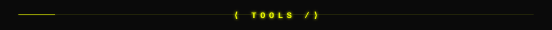

  
  
  
  

<!-- 8. PROJECT / REPO PILIHAN (card-style) -->

  
  

<!-- Mau nambah repo? Copas blok <a> di atas, ganti 3x NAMA-REPO:
  
-->

<!-- ═══════════════ BAGIAN 3 (No. 9 - 10) ═══════════════ -->


<!-- 9. SOSIAL MEDIA (bisa diklik) -->
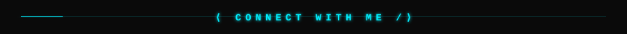

  
  
  

<!-- 10. ANIMASI GAME (digenerate otomatis oleh GitHub Actions - 8 games!) -->

<!-- 🕹️ Pac-Man -->

  

  <picture>
    <source media="(prefers-color-scheme: dark)" srcset="https://raw.githubusercontent.com/Febywi/Febywi/output/pacman-contribution-graph-dark.svg" />
    
  </picture>

<!-- 🧱 Breakout -->

  

  <picture>
    <source media="(prefers-color-scheme: dark)" srcset="https://raw.githubusercontent.com/Febywi/Febywi/output/breakout-contribution-graph-dark.svg" />
    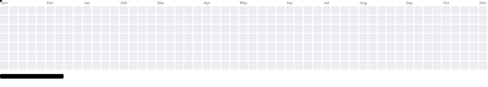
  </picture>

<!-- 🚀 Galaga -->

  

  <picture>
    <source media="(prefers-color-scheme: dark)" srcset="https://raw.githubusercontent.com/Febywi/Febywi/output/galaga-contribution-graph-dark.svg" />
    
  </picture>

<!-- 🫧 Puzzle Bobble -->

  

  <picture>
    <source media="(prefers-color-scheme: dark)" srcset="https://raw.githubusercontent.com/Febywi/Febywi/output/puzzle-bobble-contribution-graph-dark.svg" />
    
  </picture>

<!-- 💣 Bomberman -->

  

  <picture>
    <source media="(prefers-color-scheme: dark)" srcset="https://raw.githubusercontent.com/Febywi/Febywi/output/bomberman-contribution-graph-dark.svg" />
    
  </picture>

<!-- 💎 Minesweeper -->

  

  <picture>
    <source media="(prefers-color-scheme: dark)" srcset="https://raw.githubusercontent.com/Febywi/Febywi/output/minesweeper-contribution-graph-dark.svg" />
    
  </picture>

<!-- 🐍 Snake -->

  

  <picture>
    <source media="(prefers-color-scheme: dark)" srcset="https://raw.githubusercontent.com/Febywi/Febywi/output/snake-contribution-graph-dark.svg" />
    
  </picture>

<!-- 🟪 Tetris -->

  

  <picture>
    <source media="(prefers-color-scheme: dark)" srcset="https://raw.githubusercontent.com/Febywi/Febywi/output/tetris-contribution-graph-dark.svg" />
    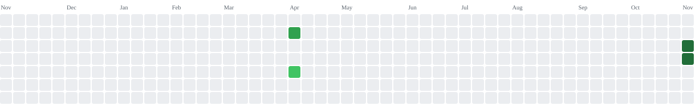
  </picture>


